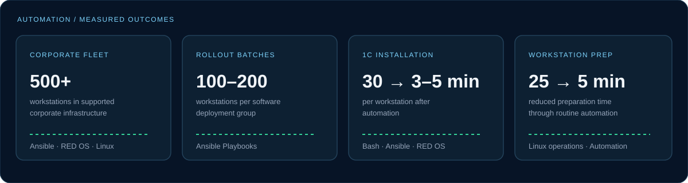
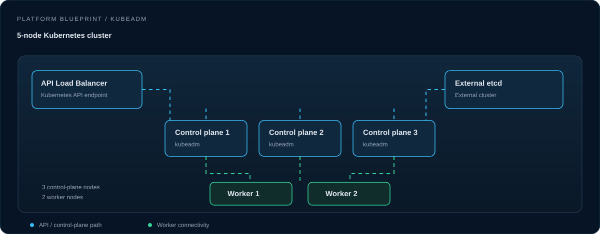
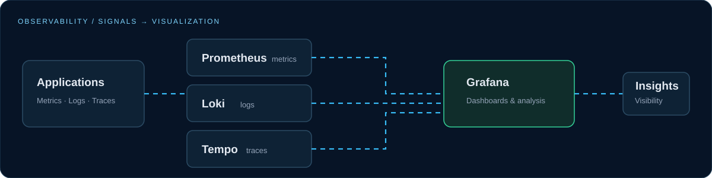
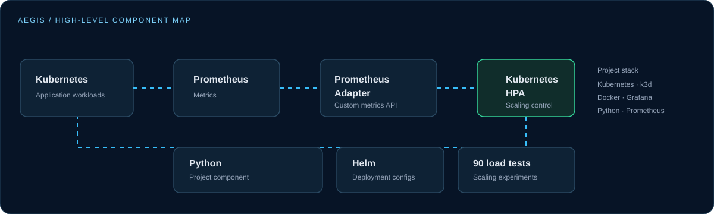

  

<strong>INFRASTRUCTURE ENGINEER</strong> · Linux · Kubernetes · Automation · Cloud

<a href="mailto:antonyuk@vacdev.ru">Email</a> · <a href="https://t.me/danisssimooooooo">Telegram</a> · <a href="https://github.com/vACLavvv">GitHub</a>

---

## `whoami`

I'm **Daniil Antonyuk**, an Infrastructure Engineer focused on Linux systems, Kubernetes platforms, infrastructure automation, and reliable application delivery.

My commercial experience combines enterprise Linux operations with container orchestration, Infrastructure as Code, CI/CD, and observability. I work with both platform-level infrastructure and the automation that makes deployments repeatable.

## `01 / Engineering impact`

| Area | Experience and results |
|---|---|
| Kubernetes migration | Migrated **15 projects** from Docker Compose to Kubernetes |
| Helm | Developed **10+ Helm charts** for parameterized deployments |
| Cluster operations | Operated a **5-node kubeadm cluster**: 3 control-plane and 2 worker nodes, with external etcd and an API load balancer |
| Infrastructure as Code | Reduced isolated development-environment provisioning from **2 days to 5 minutes** using Terraform |
| Linux automation | Reduced 1C installation time from **~30 minutes to 3–5 minutes** per workstation |
| Workstation automation | Reduced workstation preparation time from **~25 minutes to ~5 minutes** |
| Fleet operations | Supported corporate infrastructure covering **500+ workstations**; automated software rollouts in batches of **100–200 workstations** |
| AEGIS | Conducted **90 load-testing experiments** for predictive Kubernetes autoscaling |

## `02 / Platform engineering`

### Kubernetes & containerization

- Migrated 15 Docker Compose projects to Kubernetes and standardized deployment practices.
- Developed 10+ Helm charts for configurable application releases across environments.
- Deployed and operated a 5-node Kubernetes cluster with `kubeadm` (3 control-plane, 2 worker).
- Used an external etcd cluster and a load balancer for Kubernetes API access.
- Worked with Docker and containerized application environments.

### Infrastructure as Code & cloud

- Provisioned isolated development environments with Terraform, reducing setup time from 2 days to 5 minutes.
- Provisioned **2 virtual machines across 2 subnets** in Yandex Cloud.
- Automated server configuration and environment preparation with Ansible.

### CI/CD & delivery

- Implemented Git-based configuration delivery: deployment starts after changes are merged into `main`.
- Used Git revert to roll back configuration changes.
- Worked with GitLab CI/CD, Git, and Container Registry.

## `03 / Automation & operations`

- Developed Ansible playbooks and Bash scripts to automate installation of multiple 1C versions and other software on RED OS workstations.
- Automated software deployment to groups of 100–200 workstations.
- Built a RED OS 8 domain-join script using `realmd` / `realm join`, including permission and server-availability checks.
- Adapted the domain-join workflow to RED OS 8 package specifics; the solution remains in use by colleagues.
- Automated proxy configuration and IPv6 disabling with Ansible.
- Administered Active Directory users, groups, permissions, and domain-authentication troubleshooting.
- Diagnosed DNS, Kerberos, and network-connectivity issues.
- Administered SAMS / Squid proxy access rules and groups.
- Worked with backup recovery using CyberBackup and configured software RAID 10 with `mdadm` on two servers.

## `04 / Observability`

Built an observability stack with:

- **Prometheus** — metrics collection and analysis.
- **Grafana** — dashboards and visualization.
- **Loki** — centralized log collection.
- **Tempo** — distributed tracing.

Also worked with PromQL, Alertmanager, and Zabbix.

## `05 / Featured projects`

### [AEGIS — Predictive Kubernetes Autoscaling](https://github.com/vACLavvv/aegis)

Predictive monitoring and autoscaling for web applications running in Kubernetes.

**Stack:** Kubernetes, k3d, Docker, Helm, Python, Prometheus, Prometheus Adapter, Grafana, HPA.

- Implemented a predictive autoscaling mechanism for Kubernetes applications.
- Integrated Prometheus, Prometheus Adapter, and Kubernetes HPA.
- Prepared Helm configurations for deploying project components.
- Ran 90 load-testing experiments to analyze scaling behavior and resource consumption.

### More projects

| Project | Focus |
|---|---|
| [CI/CD Pipelines](https://github.com/vACLavvv/cicdpipelines) | CI/CD pipeline practice and delivery automation |
| [Static Blue-Green Deployment](https://github.com/vACLavvv/static-bluegreen-deploy) | Blue-green deployment and rollback |
| [Process Monitor](https://github.com/vACLavvv/process-monitor) | Linux process monitoring |
| [DevOps Engineer Basics](https://github.com/vACLavvv/devops-engineer-basics) | DevOps and infrastructure fundamentals |
| [Invoice Keeper](https://github.com/vACLavvv/invoice-keeper) | Backend project in Go |
| [React App Deployment](https://github.com/vACLavvv/react-app-deploy) · [Test React App](https://github.com/vACLavvv/test-react-app) | Application deployment practice |

## `06 / Technical toolkit`

| Domain | Technologies |
|---|---|
| Operating systems | Linux, RED OS |
| Scripting & programming | Bash, Python, Go |
| Containers | Docker, Docker Compose |
| Orchestration | Kubernetes, kubeadm, Helm, etcd |
| Infrastructure as Code | Terraform, Ansible, Ansible Playbooks |
| Cloud | Yandex Cloud |
| CI/CD & version control | GitLab CI/CD, Git, Container Registry |
| Observability & monitoring | Prometheus, PromQL, Grafana, Alertmanager, Loki, Tempo, Zabbix |
| Networking & identity | TCP/IP, DNS, SSH, Nginx, Squid, Active Directory, Kerberos, realmd |
| Storage & recovery | RAID, mdadm, Backup & Recovery, CyberBackup |
| Databases | PostgreSQL |

## `07 / Education & languages`

- **MSc, AI Technologies and Intelligent Systems** — Rostov State Transport University, 2025.
- **BSc, Information Systems and Technologies** — Rostov State Transport University, 2023.
- **Russian:** Native · **English:** B2.

<strong>Infrastructure as Code · Automation · Reliability</strong> Design it. Automate it. Operate it.

