<div align="center">
  
</div>

<br />

<div align="center">
  
</div>

### `> system architecture / what I build`

<table>
  <tr>
    <td width="33%" align="center"></td>
    <td width="33%" align="center"></td>
    <td width="33%" align="center"></td>
  </tr>
</table>

### `> engineering impact`

```text
INFRASTRUCTURE     Kubernetes HA · 3 control-plane · 2 worker nodes · external etcd
AUTOMATION         Linux / RedOS · Bash · Ansible · ~500 hosts in scope
DELIVERY           GitLab CI/CD · Docker · Helm · Blue-Green deployments
CLOUD & IaC        Terraform · Yandex Cloud
OBSERVABILITY      Prometheus · Grafana · predictive monitoring research
```

- **Linux automation:** reduced the 1C installation workflow from approximately **30 minutes to 3–5 minutes per workstation**.
- **Kubernetes:** deployed a **5-node cluster** with an external etcd topology and an API load balancer.
- **AEGIS research:** explored predictive workload monitoring and autoscaling, including **90 load-testing experiments**.

### `> projects / selected work`

| Repository | Focus | Stack |
| :--- | :--- | :--- |
| **[AEGIS](https://github.com/vACLavvv/aegis)** | Predictive infrastructure monitoring and Kubernetes autoscaling research | Python · Kubernetes · Prometheus · HPA |
| **[CI/CD Pipelines](https://github.com/vACLavvv/cicdpipelines)** | Delivery pipeline configuration and automation practice | GitLab CI/CD · Git |
| **[Static Blue-Green Deploy](https://github.com/vACLavvv/static-bluegreen-deploy)** | Deployment strategies, release switching and rollback | Linux · Shell · Web |
| **[Process Monitor](https://github.com/vACLavvv/process-monitor)** | Linux process monitoring and operational tooling | Shell · Linux |
| **[Invoice Keeper](https://github.com/vACLavvv/invoice-keeper)** | Backend engineering project | Go |

### `> delivery pipeline / concept`

<div align="center">
  
</div>

<details>
<summary><strong>Show full technical toolbox</strong></summary>
<br />

| Area | Technologies |
| :--- | :--- |
| **Systems** | Linux, RedOS, Bash, Python, Go, systemd |
| **Containers** | Docker, Docker Compose, Kubernetes, kubeadm, Helm |
| **IaC & automation** | Terraform, Ansible, GitLab CI/CD, Git |
| **Monitoring** | Prometheus, Grafana |
| **Cloud & network** | Yandex Cloud, Nginx, TCP/IP, DNS, SSH |
| **Enterprise infra** | Active Directory, Kerberos, mdadm, RAID |

</details>

---

<div align="center">
  <strong>Build reliable systems. Automate the routine. Understand the failure modes.</strong>
  <br /><br />
  <a href="mailto:antonyuk@vacdev.ru">Email</a> · <a href="https://github.com/vACLavvv?tab=repositories">Repositories</a> · <a href="https://github.com/vACLavvv/aegis">AEGIS</a>
</div>

<!-- Animations are self-contained CSS/SVG. The diagrams are visual explanations, not live infrastructure status indicators. -->
